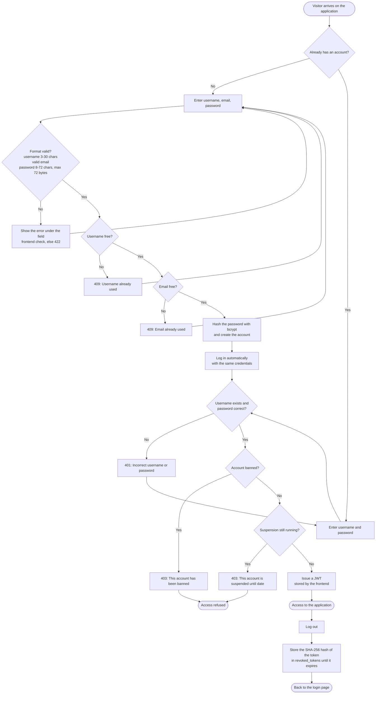

# Activity Diagram - F1: Sign up, log in, log out

Routes: `POST /api/auth/register`, `POST /api/auth/login`, `POST /api/auth/logout` (`auth_routes.py`, `UserService.register` / `login`, `TokenService.revoke`).

No page of the application can be used anonymously: every route except `register` and `login` requires a valid JWT.

While the user is logged in, every request goes through `deps.get_user()`. It rejects (403) a revoked or invalid token, a deleted account, and an account banned or suspended after the token was issued. The frontend then sends the user back to the login page.
