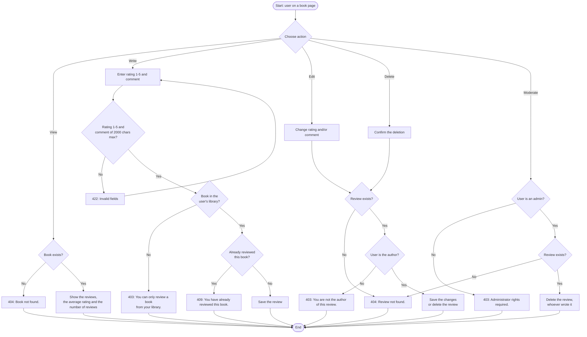

# Activity Diagram - F4: Reviews

Routes: `GET /api/books/{book_id}/reviews`, `POST /api/books/{book_id}/reviews`, `PUT /api/reviews/{review_id}`, `DELETE /api/reviews/{review_id}`, `GET /api/users/{user_id}/reviews` (`reviews_routes.py`, `ReviewService`) and, for admins, `DELETE /api/admin/reviews/{review_id}` (`admin_routes.py`, `AdminService`).

A review is a rating from 1 to 5 with an optional comment of at most 2000 characters.

