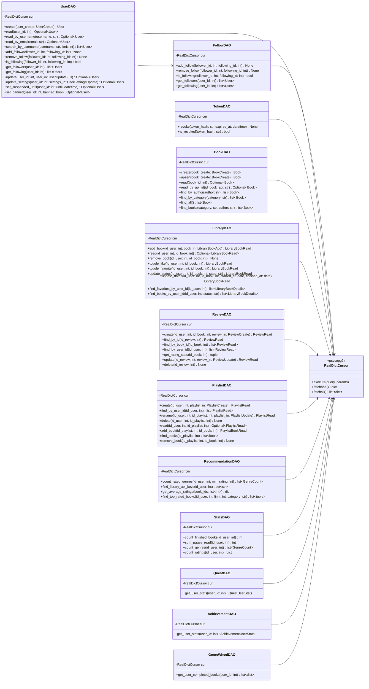
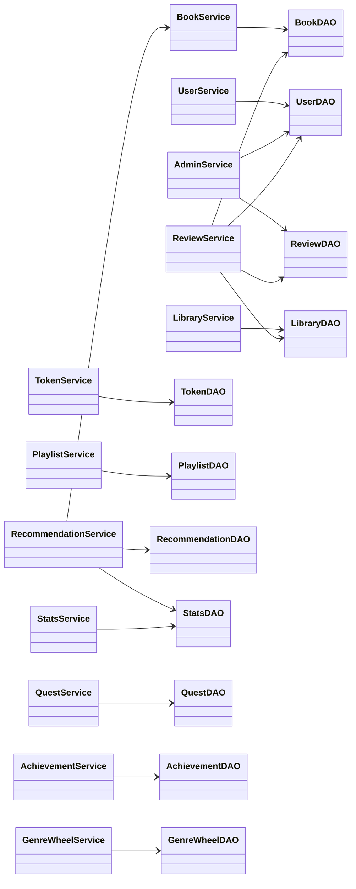

# DAO Class Diagrams - Ex-Libris

The data access layer (`src/dao/`) has one concrete class per data domain. There is no abstract `GenericDAO` interface: each DAO receives the request's `psycopg2` `RealDictCursor` in its constructor, runs plain SQL and converts rows into Pydantic models. Database errors are translated into business exceptions (`DAOError`, `BookAlreadyInLibraryError`, `ReviewAlreadyExistsError`, ...) so that services never see `psycopg2` errors.

---

## Diagram 1: DAO classes

### Tables used by each DAO

| DAO | Tables |
|---|---|
| `UserDAO` | `users` |
| `FollowDAO` | `user_follows`, `users` |
| `TokenDAO` | `revoked_tokens` |
| `BookDAO` | `books` |
| `LibraryDAO` | `user_book_activities`, `books` |
| `ReviewDAO` | `reviews` |
| `PlaylistDAO` | `playlists`, `playlist_books`, `books` |
| `RecommendationDAO` | `reviews`, `books`, `user_book_activities` |
| `StatsDAO` | `user_book_activities`, `books`, `reviews` |
| `GenreWheelDAO` | `user_book_activities`, `books`, `reviews` |
| `QuestDAO`, `AchievementDAO` | all tables except `revoked_tokens` (one aggregated query of counters) |

---

## Diagram 2: Services and the DAOs they use

Notes:

- The wiring is done in `src/api/deps.py` (`get_user_service`, `get_review_service`, `get_recommendation_service`, ...). All the DAOs of one request share the same cursor, so the request is a single transaction: `get_cursor` commits at the end of the request and rolls back on any exception.
- Unit tests replace the DAOs with mocks (`tests/mocks.py`), and integration tests in `tests/integration/dao/` run each DAO against a real PostgreSQL database.
