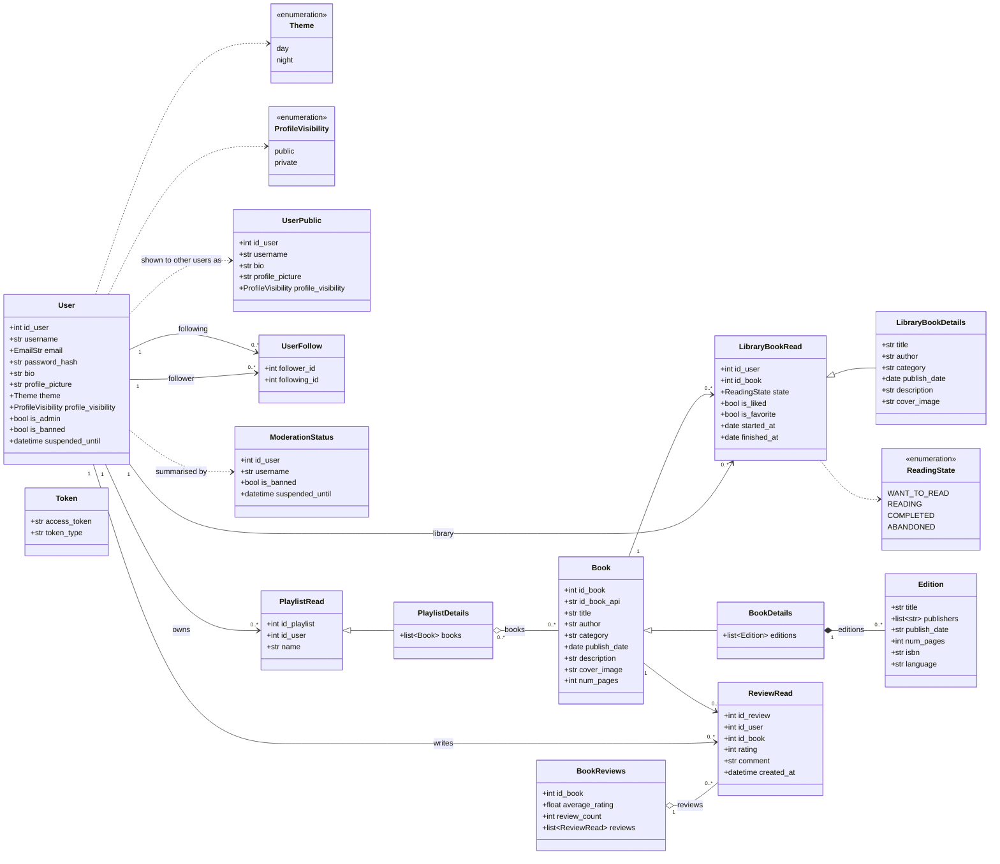
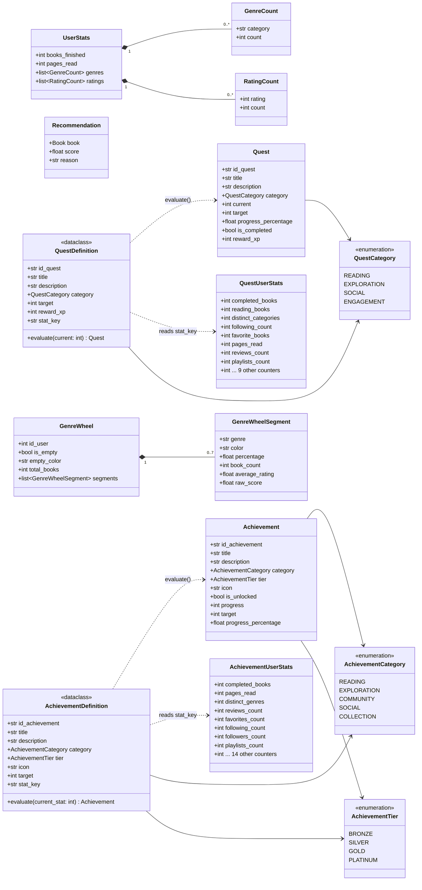
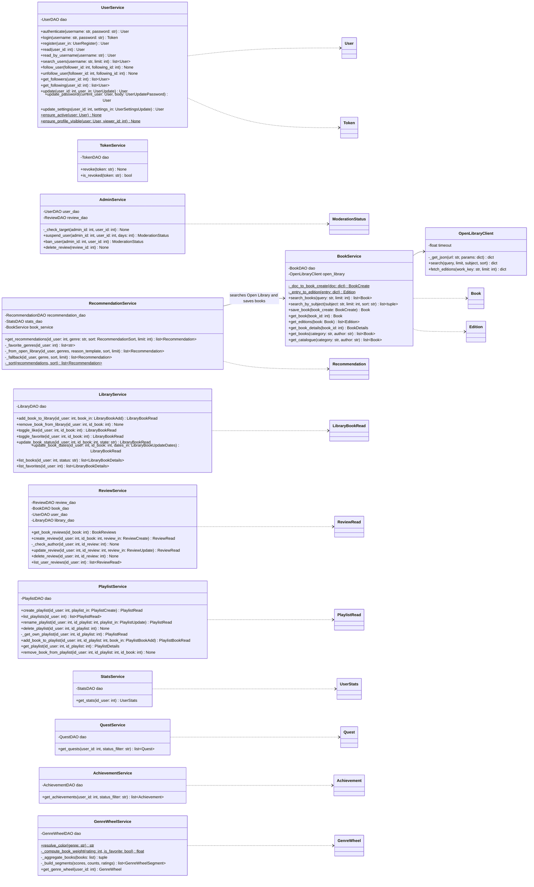

# Class Diagrams - Ex-Libris

Three diagrams, each matching a package of `src/`:

1. **Business models**: the Pydantic models of `src/models/` that map to database rows.
2. **Statistics and gamification models**: computed objects that are never stored (stats, quests, achievements, genre wheel, recommendations).
3. **Services**: the business layer of `src/services/`.

The DAO layer is in [class_dao_diagram.md](class_dao_diagram.md).

Input-only models (`UserRegister`, `UserUpdate`, `UserSettingsUpdate`, `UserUpdatePassword`, `LibraryBookAdd`, `LibraryBookUpdateStatus`, `LibraryBookUpdateDates`, `ReviewCreate`, `ReviewUpdate`, `PlaylistCreate`, `PlaylistUpdate`, `PlaylistBookAdd`, `SuspendRequest`, `BookCreate`) are left out to keep the diagrams readable. Each one carries a subset of the attributes of the model it creates or updates.

---

## Diagram 1: Business models

Notes:

- `User` is the full database row. It is never returned as is: the API returns `UserRead` for one's own profile, `UserMe` for one's settings and `UserPublic` for other users' profiles (no email, no settings).
- `ReadingState`, `Theme` and `ProfileVisibility` are shown as enumerations. In the code, `state` is a string validated by a regex and `Theme` / `ProfileVisibility` are `Literal` types.
- `BookDetails.editions` is fetched live from Open Library and never stored.

---

## Diagram 2: Statistics and gamification models

Notes:

- 32 quests and 55 achievements are declared as constants (`QUESTS`, `ACHIEVEMENTS`) in their services. Each definition names the counter it tracks (`stat_key`); the service fetches all counters in one query and calls `evaluate()` on every definition.
- The genre wheel keeps at most 7 segments. Genres under 3 % of the total weight are dropped and the remaining shares are rescaled to 100 %.

---

## Diagram 3: Services

Notes:

- Each service is built per request by a FastAPI dependency in `src/api/deps.py`, with DAOs that share the request's database cursor (one transaction per request).
- `BookService` uses `OpenLibraryClient` to call Open Library (`/search.json` for searches and recommendations, `/works/{key}/editions.json` for editions).
- Static methods are marked with `$`. Private helpers start with `-`.
