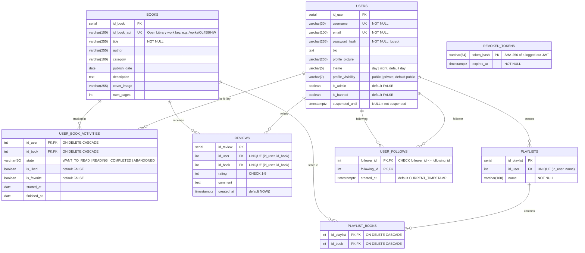

# Database Diagram - Ex-Libris

Source of truth: [`data/init.sql`](../data/init.sql). PostgreSQL schema, 8 tables.

## Notes

- Every foreign key uses `ON DELETE CASCADE`: deleting a user or a book removes its library entries, reviews, playlists, playlist links and follows.
- `user_book_activities.state` has no SQL `CHECK`. The four allowed values are enforced by the Pydantic models (`LibraryBookAdd`, `LibraryBookUpdateStatus`).
- A user can review a book **once** (`UNIQUE (id_user, id_book)`) and cannot have two playlists with the same name (`UNIQUE (id_user, name)`).
- `revoked_tokens` is not linked to `users`: it only stores the hash of JWTs revoked by `POST /auth/logout` until they expire.
- `books` acts as a local cache of Open Library: a row is upserted on `id_book_api` each time a book appears in a search or a recommendation.
