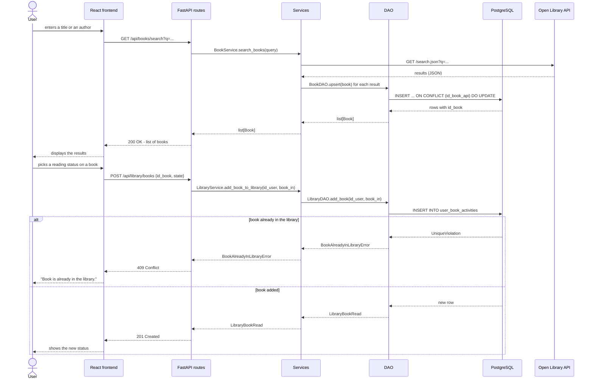

# Ex-Libris — Sequence Diagram (F2: Search + F3: Add to Library)

High-level view, one participant per layer of the application. The detailed versions are [sequence_diagram_detailed.md](sequence_diagram_detailed.md), [sequence_diagram_f2.md](sequence_diagram_f2.md) and [sequence_diagram_f3.md](sequence_diagram_f3.md).

