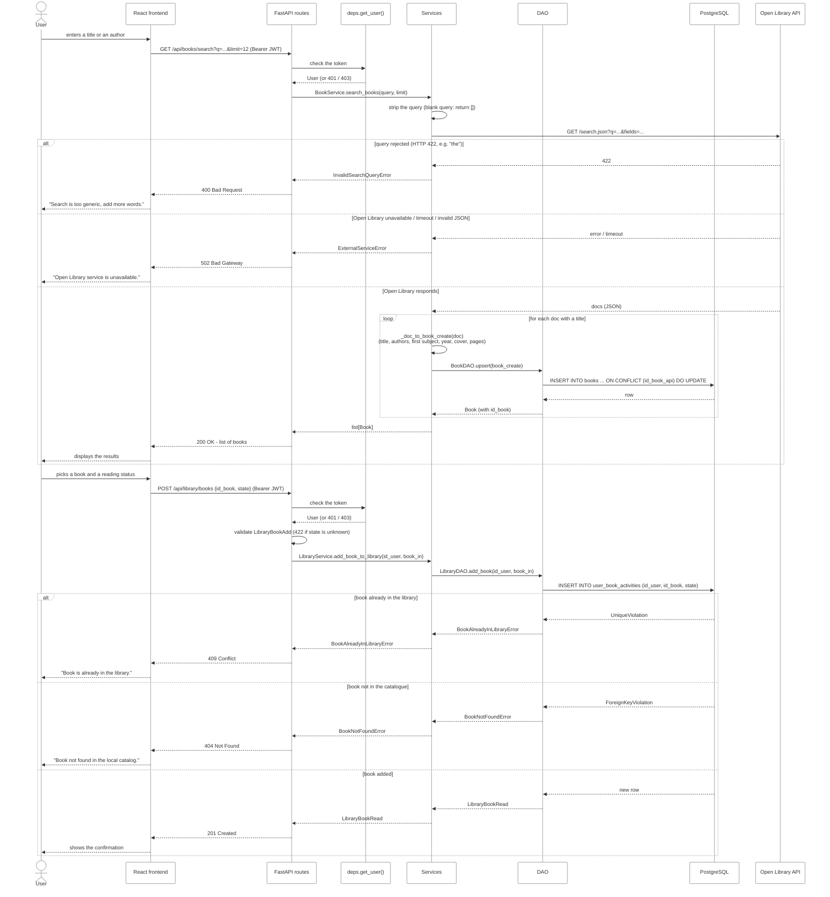

# Ex-Libris — Detailed Sequence Diagram (F2: Search + F3: Add to Library)

Same scenario as [sequence_diagram.md](sequence_diagram.md), with the authentication step and all the error cases. Each feature also has its own file: [F2](sequence_diagram_f2.md), [F3](sequence_diagram_f3.md).

