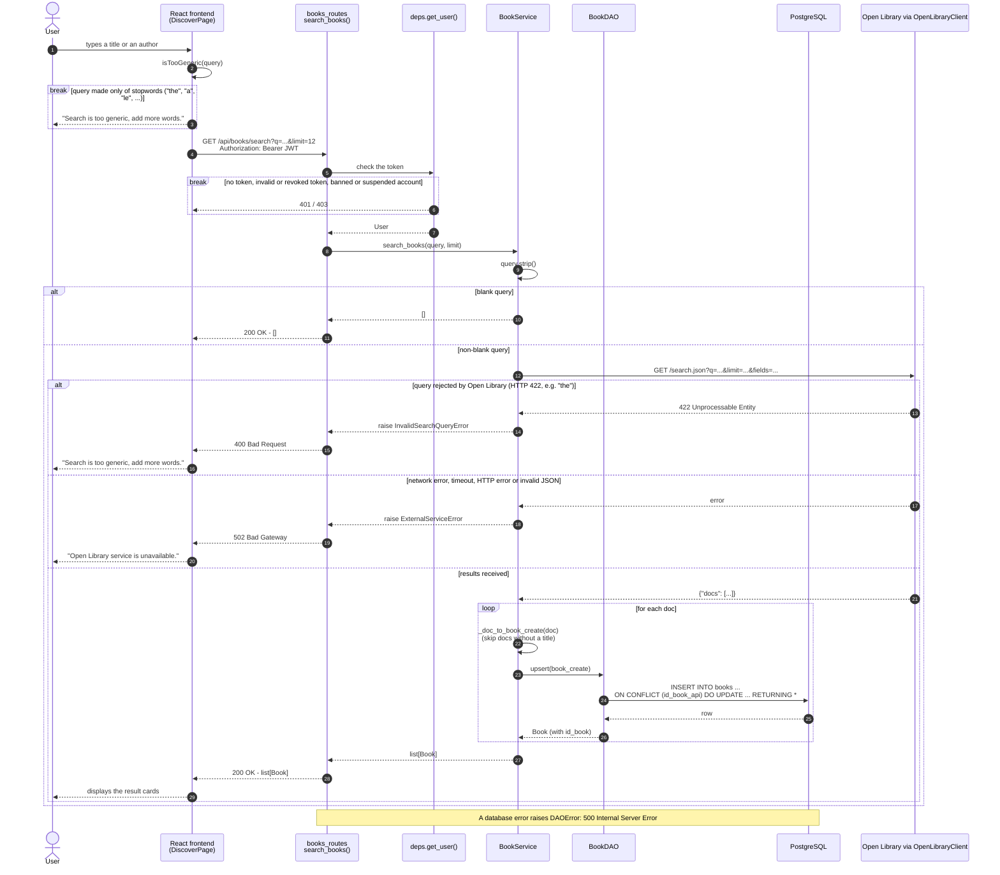

# Sequence Diagram - F2: Search a book

`GET /api/books/search` → `books_routes.search_books` → `BookService.search_books` → `OpenLibraryClient.search` + `BookDAO.upsert`.

Each book found is saved (or refreshed) in the local `books` table. That gives it an `id_book` that the library, playlist and review routes can use.

