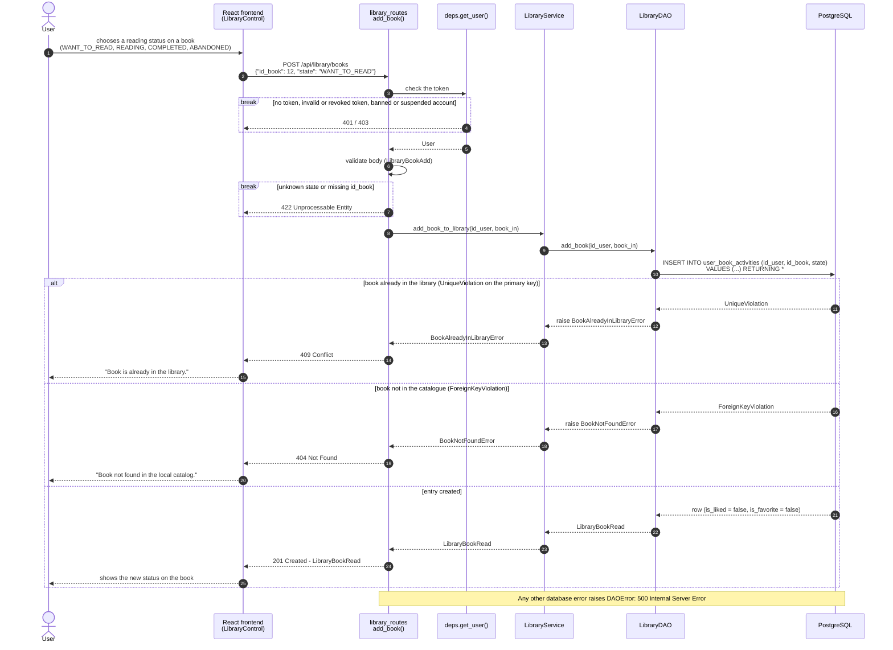

# Sequence Diagram - F3: Add a book to the library

`POST /api/library/books` → `library_routes.add_book` → `LibraryService.add_book_to_library` → `LibraryDAO.add_book`.

Open Library is not called here: the book is already in the local `books` table, because the user found it through a search, a recommendation or the catalogue (see F2). The request only sends its `id_book`.

Once the book is in the library, the same entry is updated by `PATCH /api/library/books/{id_book}/status`, `PATCH .../dates`, `POST .../like`, `POST .../favorite` and removed by `DELETE /api/library/books/{id_book}`.
