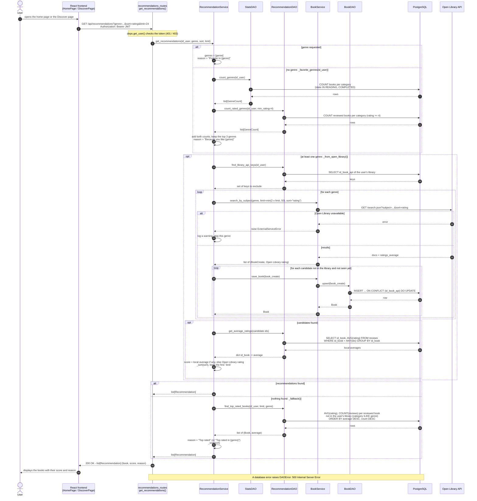

# Sequence Diagram - F5: Book recommendations

`GET /api/recommendations` → `recommendations_routes.get_recommendations` → `RecommendationService.get_recommendations`.

Three sources, tried in this order:

1. **Requested genre** (`?genre=...`): popular Open Library books of that genre, reason `"Popular in {genre}"`.
2. **Favorite genres** (no genre given): the 3 most frequent genres among the user's `READING` / `COMPLETED` books and the books they rated 4 or 5, reason `"Because you like {genre}"`.
3. **Fallback**: if there is no genre, Open Library fails, or no book is left, the best rated books reviewed on Ex-Libris, reason `"Top rated"`.

Books already in the user's library are never recommended.

`sort` can be `rating` (highest score first, default), `new` (most recent publication first) or `title` (alphabetical).
