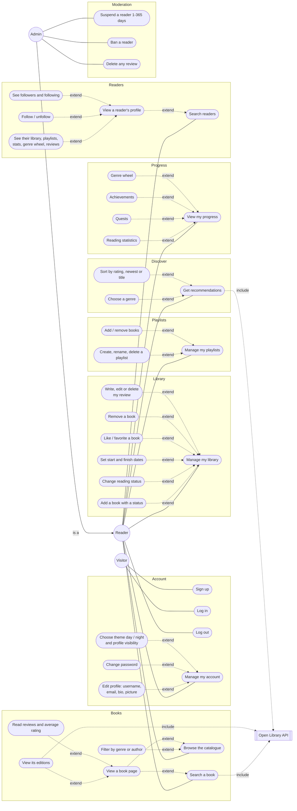

# Use Case Diagram - Ex-Libris

Mermaid has no native use case diagram, so this one is drawn as a flowchart: circles are actors, rounded boxes are use cases, and dotted `extend` / `include` arrows follow UML (from the extension to the base use case, from the base to the included one).

Three actors:

- **Visitor**: not logged in; can only sign up or log in.
- **Reader**: a logged-in user; every other feature requires an account.
- **Admin**: a reader with `is_admin = TRUE`, who can also moderate.

Notes:

- **Private profiles**: when a reader sets their profile to private, other readers still see their name, bio and picture, but get a 403 on their library, playlists, stats and genre wheel. Reviews stay public because they are also shown on book pages.
- **Reviews**: a reader can only review a book that is in their own library, and only once per book (see [activity_diagram_f4.md](activity_diagram_f4.md)).
- **Moderation**: an admin cannot suspend or ban themselves or another admin. A banned or suspended reader is logged out on their next request.
